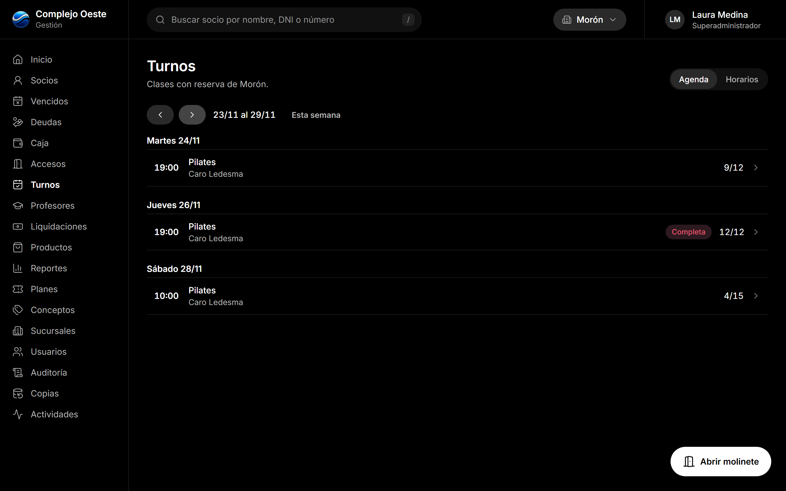
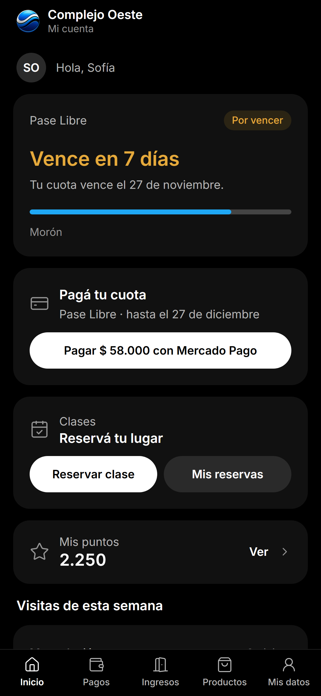
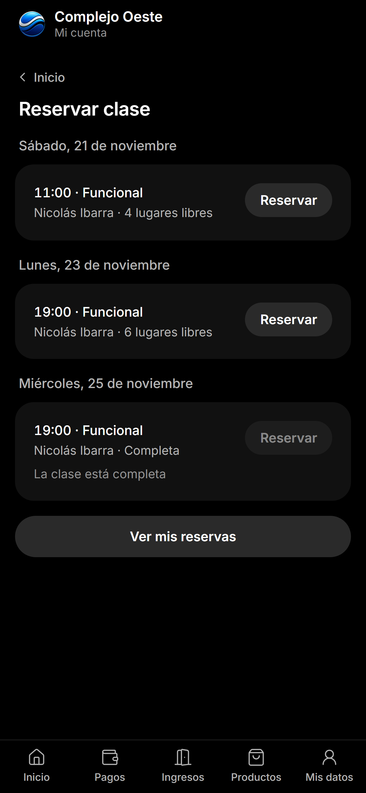
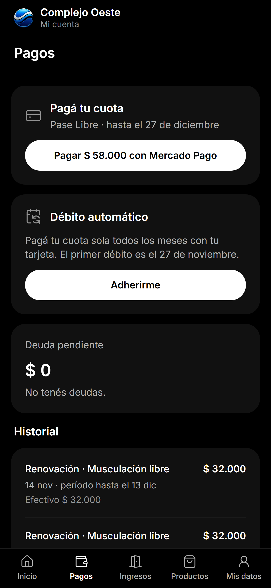
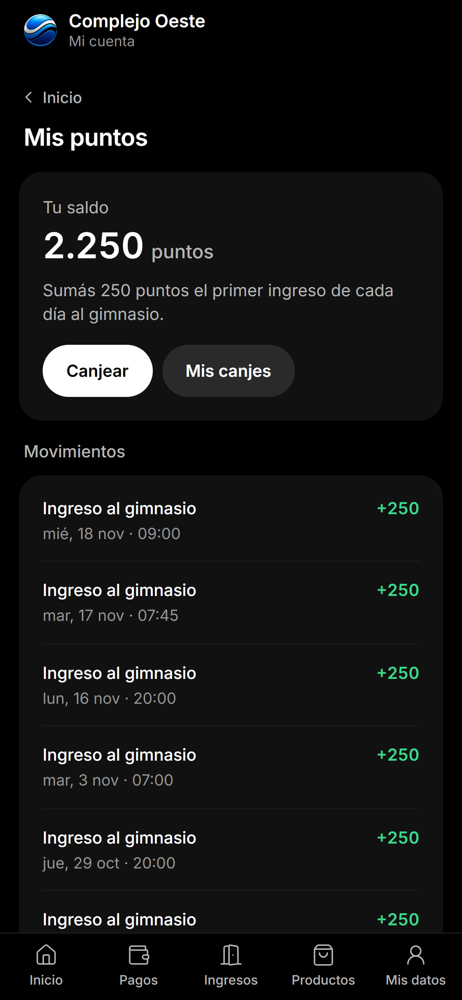
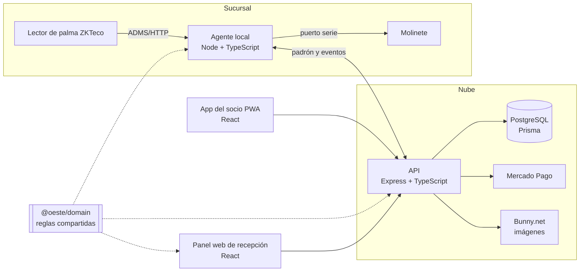

# Complejo Oeste — Gestión y control de acceso para gimnasios

> 🔒 **El código es privado** porque es un sistema comercial en uso. Para procesos de selección
> puedo dar acceso de lectura al repositorio o mostrarlo en una llamada: escribime (ver
> [Contacto](#contacto)).

Sistema completo para un gimnasio con varias sucursales: socios, membresías, cobros, caja, turnos,
productos y **control de acceso biométrico** con lector de palma y molinete. Incluye el panel de
recepción, una app para los socios y un agente local que abre el molinete **aunque no haya
internet**.

  

  
  
  
  

🎬 **Videos:** [App del socio](media/demo-app-socio.mp4) · [Reserva de turnos](media/demo-reserva-turnos.mp4)

## Qué resuelve

- **Acceso biométrico:** el socio apoya la palma en el lector y el sistema decide al instante si
  puede pasar (cuota al día, horario, sucursal). Si puede, abre el molinete.
- **Recepción:** alta de socios con foto, cobro de cuotas, caja diaria, ventas, deudas y
  vencimientos.
- **App del socio (PWA):** estado de la cuota, pago con Mercado Pago, reserva de clases, compra
  de productos, programa de puntos y avisos push.
- **Administración:** varias sucursales, roles y permisos, reportes, liquidaciones de profesores,
  auditoría y copias de seguridad.

## Arquitectura

- **Monorepo con pnpm:** API, panel web, agente local y un paquete de dominio compartido.
- **Funciona sin internet:** el agente guarda una copia del padrón y decide el acceso con las
  mismas reglas de negocio que la nube (el paquete `domain`), así nunca difieren. Los eventos
  se sincronizan después, con reintentos y sin duplicados.
- **Pagos:** Checkout Pro de Mercado Pago con webhooks que registran la venta, descuentan stock y
  cargan el ingreso en la caja.

## Stack

| Capa          | Tecnología                                                                |
| ------------- | ------------------------------------------------------------------------- |
| Lenguaje      | TypeScript estricto en todo el proyecto                                   |
| API           | Node.js · Express 5 · Prisma 7 · PostgreSQL 17 · Zod · argon2id           |
| Web y app     | React 19 · Vite · Tailwind CSS 4 · TanStack Query · React Router · PWA    |
| Agente local  | Node.js 22 en Windows · servidor ADMS para ZKTeco · comunicación serie    |
| Integraciones | Mercado Pago · Web Push (VAPID) · Bunny.net Storage                       |
| Calidad       | Vitest (80+ archivos de pruebas) · ESLint · Prettier · pnpm workspaces    |

## Seguridad

- Contraseñas con argon2id y sesiones en cookies HttpOnly; en la base solo se guarda el hash del
  token.
- Permisos por rol y por sucursal en cada endpoint.
- Límite de intentos de login por cuenta y por IP, y control de origen en las escrituras.
- Imágenes privadas, validadas por la firma real de los bytes y servidas solo con sesión.
- Tabla de auditoría de solo agregar, protegida con un trigger de la base.

## Lo que aprendí

- Integrar hardware real (lector biométrico y molinete) con un sistema web.
- Diseñar para que el sistema siga funcionando cuando se corta internet.
- Organizar un proyecto grande en monorepo y compartir reglas de negocio entre servicios.
- Escribir pruebas, incluidas pruebas contra una base de datos aislada.

## Contacto

- LinkedIn: [linkedin.com/in/alejofre](https://www.linkedin.com/in/alejofre/)
- Email: [alejandrojofre949@gmail.com](mailto:alejandrojofre949@gmail.com)
